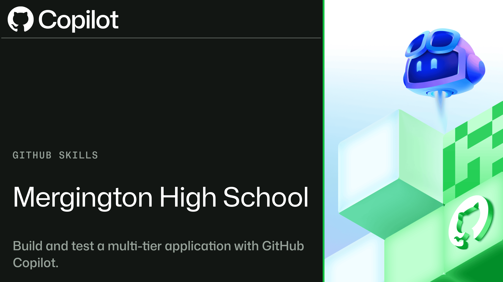

# Build and test a multi-tier application with GitHub Copilot

## Welcome

Build OctoFit Tracker as a three-tier application using React, Express, and MongoDB. Work through the data, API, and presentation contracts in `docs/architecture.md` and the step-by-step guides in `.github/steps/`.

The starter uses MongoDB on port 27017, the Express API on port 8000, and Vite on port 5173. Start with the commands in `docs/architecture.md`; API traffic from the browser is proxied through Vite.

## Having trouble? 🤷

- Run the focused contract tests documented in `docs/architecture.md` to identify which tier needs attention.
- Keep API validation and business behavior in the backend service layer, and render loading, error, and empty states in the frontend.
- Preserve unrelated MongoDB data when running the seed script.
